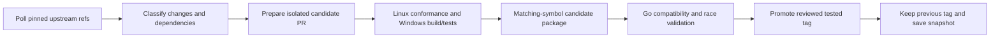

# Vita3K-ZipZ: source selection, validation and update plan

Status: proposal based on source inspection on 2026-10-23. No scheduled merger, upstream watcher or automatic release/deployment is enabled by this document. Current Windows builds remain manually dispatched to the dedicated runner. Source pins are in [upstream-sources.proposal.json](upstream-sources.proposal.json).

## Recommendation

Keep the tested Plus-derived build as the working reference while evaluating a mainline-based future branch. Track original Vita3K as the primary long-term upstream, Plus `all-enhancements` for its compatibility/scheduling changes, and nx for selected shared-code improvements. Maintain our decoded-texture cache, UI, audio-span correction and reproducible symbol packaging as a small explicit patch set. Each accepted change needs an origin, dependencies, tests and retirement condition.

Automation can detect new commits, prepare candidate branches, build and test them, and retain downloads with matching symbols. Promotion to the tested channel follows gameplay validation. Semantic conflicts and compatibility regressions still require judgment; a successful merge/build alone cannot establish that a racing game works or feels better.

## What the histories actually contain

| Source/ref | Observed commit | Mainline-only / source-only reachable commits | Role |
|---|---|---:|---|
| [Vita3K master](https://github.com/Vita3K/Vita3K/commit/5844e21fb6d7259a31ba1f13b98ed1a648170052) | `5844e21fb` | 0 / 0 | Long-term upstream and conformance baseline |
| [Plus master](https://github.com/nckstwrt/Vita3K-Plus/commit/28dd8fb231c6a90dc810b41d608a9b422fc7a60c) | `28dd8fb23` | 162 / 35 | Release/documentation context; not the full scheduler source |
| [Plus all-enhancements](https://github.com/nckstwrt/Vita3K-Plus/commit/a86b5f93db43e4c4640ad1527e2a4695aad0f35b) | `a86b5f93d` | 162 / 213 | Current diagnostic code baseline |
| [nx master](https://github.com/NaGaa95/Vita3K-nx/commit/db030b5ab121b37d3e1c12fd78562b60c5ef86ff) | `db030b5ab` | 125 / 236 | Switch port with shared-code candidates |

Reachable commit counts are not independent features. Different commits can already implement equivalent fixes. Non-mutating merge previews report **71 conflicting paths** for mainline+Plus and **58** for mainline+nx. These counts describe the pinned trees, not an attempted resolved integration. Kernel, renderer and configuration dependencies make automatic full-fork combinations expensive to maintain.

Coverage: refreshed all four refs, inventoried nonmerge patch-distinct commit subjects and changed paths, and inspected selected relevant diffs against the current Plus-derived tree. This is a targeted review, not a correctness audit of every line in all fork commits. Earlier open-PR/issue inventories remain useful context. Some old reports predate our matching-symbol measurements.

The old mainline package repeatedly crashed loading Chenghou Project, so it never produced a valid race comparison. That does not establish that current source master will fail, or that the custom scheduler caused the difference. Our valid Ubermall captures identify repeated CPU PVRTC decoding and show improvement with the opt-in cache; a different-event capture retains a 281 ms decoding-associated gap. These findings favor narrow experiments before broad kernel changes.

## Candidate decisions from code inspection

| Origin/change | Finding in our current tree | Decision and validation |
|---|---|---|
| nx [131a9f879](https://github.com/NaGaa95/Vita3K-nx/commit/131a9f879b5aa89c1d8b61499556d7d8e2b9df64), all-mip texture sizing | Plus already calls `gxm::texture_size`, validates the range and falls back to the first mip in texture caching. | Already represented in substance; compare layout edge cases if needed. A lower-mip mutation test is useful, not a duplicate patch. |
| nx [85556014d](https://github.com/NaGaa95/Vita3K-nx/commit/85556014db0f2e157d8ded6127cb891015489203), early staging reuse | Plus already has the timestamp-underflow helper and initializes `used_so_far`. | Keep the existing fix. Test early-frame timestamps 0/1/2, sentinel and wrap boundaries when touching this code. |
| nx [9919d3fd3](https://github.com/NaGaa95/Vita3K-nx/commit/9919d3fd384c8a7f2438245b80ff965f23cb41ab), condvar timeout reacquisition | Plus already reacquires the mutex, integrated with its scheduler. | Keep existing semantics and test timeout ownership; no blind duplicate application. |
| nx [9a6b47008](https://github.com/NaGaa95/Vita3K-nx/commit/9a6b470084bf9891da1c4283101c726525cd6042), split-scene submissions | The altered submission behavior is selected under `__SWITCH__`; Windows keeps the normal vector submission. | Low priority for Windows. Its title alone suggested a broader benefit than its guarded diff supports. |
| nx [050910656](https://github.com/NaGaa95/Vita3K-nx/commit/050910656bf1007649eaf202e0a7c58d859ccaca), async compile input ownership | Our CompileRequest already retains shared ProgramBinding objects. | Audit those binding/program lifetimes first. Use destruction/recompile stress tests; replacing this with a second ownership scheme is not automatically an improvement. |
| nx [1881b9adb](https://github.com/NaGaa95/Vita3K-nx/commit/1881b9adb608bbb7e532c2d66e3a12aa0e97ae9e), shader cache identities | Shared changes pass the caller's variant hash to disk-cache lookup; our loader still recomputes a raw-program hash. Much of nx's directory indexing is Switch-only. | High-value next **correctness** audit. Build variant-key collision tests, trace all callers and adapt only the shared portion. Test separate cold/warm shader caches; no claim this explains the PVRTC hitches. |
| mainline [e9225f90f](https://github.com/Vita3K/Vita3K/commit/e9225f90f04cdf0d6d7c6fe617c0c70a5a0af84a), NGS output patches | Plus already returns PATCH_NOT_AVAIL for missing routes, but still dereferences a non-null stored patch without mainline's validity guard. | Narrow candidate: preserve Plus's return behavior and add the missing invalid-handle check. Test null/missing/disconnected/invalid/valid routes and normal music. Separate from our ATRAC9 span regression. |
| mainline [bf607dbdd](https://github.com/Vita3K/Vita3K/commit/bf607dbddd7eaca1f7e7137270e745c42689f786), RGBA4444 capabilities | Plus still selects native RGBA4444 in format mapping; mainline queries usage/capabilities and supports RGBA8 fallback. | Compatibility candidate requiring the full surface-format path, not one enum edit. Verify packed uploads/readback and Chenghou loading on AMD. No proven link to our driver fault. |
| mainline [50c3e8351](https://github.com/Vita3K/Vita3K/commit/50c3e8351acd337a1c4fbb06432c9f25593faf11), minimum LOD ordering | Plus already has `true_lod_min()` and matching set-bit ordering. | Retain; do not count it as a new improvement. |
| mainline sync-object series ending [5844e21fb](https://github.com/Vita3K/Vita3K/commit/5844e21fb6d7259a31ba1f13b98ed1a648170052) | Changes overlap heavily with the Plus scheduler/kernel. | Evaluate as a dependent series on a separate mainline-based branch, with guest conformance and scheduler A/B. A last-commit cherry-pick cannot represent the whole protocol. |

Open PRs such as mainline display queue ordering, ring-buffer lifetime, shader-manifest membership and failed-pipeline handling remain proposals until their state and exact head are checked. Some equivalent code already exists in Plus. Preserve original authorship and links when adapting a fix.

## Preserve our own fixes explicitly

1. Keep the `.2` runtime/PDB and current save as an immutable reference; `.3` validates the server toolchain and is not a new gameplay result.
2. Carry the CPU decoded-content cache and its byte-equality, collision, bounds and concurrent-access tests. Keep it opt-in while expanding coverage.
3. Carry the UI/global/per-game configuration, restart behavior and legacy-profile tests as a separate change. Keep the diagnostic environment override explicit in documentation.
4. Retain the corrected actual remaining ATRAC9 superframe span, consumed-byte checks and codec test. The earlier silent music was our diagnostic regression, not a demonstrated published Plus bug.
5. Make missing Plus build inputs explicit: generated fork identity and bounded LibAtrac9 implementation. Eventually track the dependency fix in a pinned dependency fork or a checksummed patch entry, rather than relying on an unpublished release modification.
6. Use one optimized source/build line with separate PDB downloads. Record source/submodules, patch hashes, recipe, compiler/SDK/Qt, flags, EXE/PDB hashes and GUID/age for every candidate. Retire a local patch only after an upstream equivalent passes its retained regression test.

## Proposed automation

**Watch:** a small daily job at an off-hour-minute plus manual dispatch reads only the approved source refs. Unchanged heads produce no build or repeated notification. Store last observed and last accepted SHAs separately. Report new commits, touched areas, dependencies, duplicated fixes and non-fast-forward ref changes. A rewritten/deleted ref stops candidate preparation for review.

**Prepare:** maintain fast-forward source mirror refs and one maintained development branch. Assemble a candidate from one chosen base plus an ordered patch manifest; commit accepted integrations with preserved authorship. Published development history should be advanced by reviewed merges/reverts. Rebase/recreate disposable candidates freely, preserving release tags. Each PR states exact before/after pins, tests and unresolved conflicts. A `master` name is not permission to replace the tested release.

**Build:** begin with maintainer dispatch of reviewed candidate SHAs using the working Windows workflow. Once isolation and tests are established, accepted upstream updates can trigger candidate builds automatically. The coordinator can explicitly dispatch the build; it should not assume a bot-created commit/PR will recursively trigger every workflow. GitHub [documents trigger and schedule behavior](https://docs.github.com/en/actions/reference/workflows-and-actions/events-that-trigger-workflows), including schedule delays/default-branch operation and idle-public-repository disabling. Keep a manual recovery path and a recorded last successful poll.

**Workers:** use a fork-scoped Linux container on the existing Linux server for inventories, portable unit/sanitizer tests and later headless guest tests; the existing HaupCore registrations remain unchanged. Use the dedicated Windows VM for native MSVC packages, initially one build job with six compiler workers within its 8-vCPU/16-GiB allocation. Measure warmed builds and peak RAM before increasing parallelism. Keep the local 14900K for quick diagnostic iteration and the Go for real-device validation. Share only compatible dependency cache keys; keep source/build directories separate per job and never build MSVC output on WSL sharing.

**Execution boundary:** automatically observed external code eventually runs its build scripts. Candidate workers should be isolated and disposable, with minimal credentials/network reach. The current persistent runner remains for owner-reviewed commits; public pull requests do not dispatch code onto it. Separate build/read permissions from release publishing. GitHub's [self-hosted runner guidance](https://docs.github.com/en/actions/reference/security/secure-use#hardening-for-self-hosted-runners) describes why persistent workers need this boundary. Removing a token after a build does not reset a contaminated machine.

**Promote:** a green candidate can produce a clearly labeled prerelease artifact. Advance the tested channel only after the compatibility/race checks below. Retain the prior tested package and symbols, and generate release notes from the patch manifest. Device deployment is separate from publication: make a new portable directory, snapshot after normal closure, verify hashes/settings and provide a separate shortcut. Production frontend mapping changes remain a deliberate later step.

## Validation and order of work

| Gate | Automated evidence | Device evidence / decision |
|---|---|---|
| Source/provenance | Exact refs, ordered dependencies, patch-equivalence scan plus semantic review, full manifests and PDB GUID/age | No silent baseline or graphics-profile change |
| Native correctness | Existing codec/memory/module/cache tests plus new config tests; sanitizer coverage where supported; warning/failure triage | Settings persist, legacy profiles work, music/controls/graphics remain correct |
| Guest/kernel | Adapt pinned mainline [VitaAutotests runner](https://github.com/Vita3K/Vita3K/blob/5844e21fb6d7259a31ba1f13b98ed1a648170052/.ci/run-autotests.sh): fresh XDG directories and Linux lavapipe; pin test/compiler container inputs rather than using an unrecorded latest image | Kernel/scheduler changes need additional pause/resume, callbacks and teardown stress |
| Compatibility | Automated startup/exit only where reliable; save hashes before/after | Three independent Chenghou loads, Ubermall, music continuity and selected already-working games; keep saves separate |
| Pacing | Shared-QPC presents/CPU/scheduling, valid trace/loss checks and cache telemetry | At least three paired active-race runs per condition, recorded event/ship and cold/warm state; compare p99, >50/>100 ms rates and worst gaps with context |
| Promotion/rollback | Versioned runtime/symbol packages, repeatable build recipe and previous artifacts retained | No new crash/audio/control/save regression; establish numeric pacing tolerances from repeat variability rather than one lucky run |

Immediate sequence: finish and stage the UI-cache build; obtain owner feedback after waking; audit the shader variant-key and NGS validity candidates in separate commits; create a fresh current-mainline reference build; then choose between continuing Plus with targeted imports and migrating the curated patch set onto mainline. Keep nx's shared-code work in the review feed, with Switch-only changes filtered out. Only after these gates are repeatable should the source watcher and automatic candidate rebuilds be enabled.
